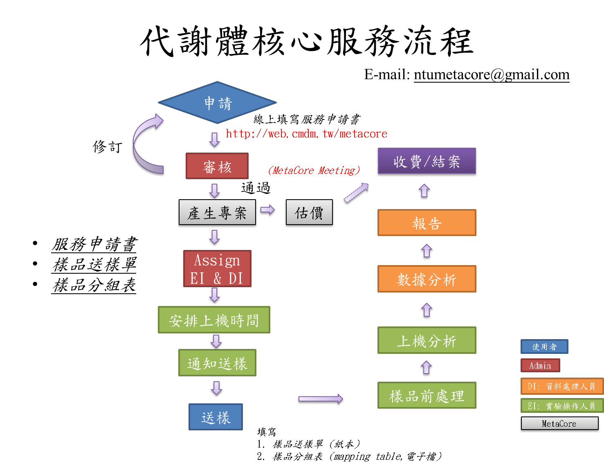

<iframe src="https://www.slideshare.net/slideshow/embed_code/key/x9BQqcgd6bOQfX" title="MetaCore 分析服務申請操作範例" loading="lazy" allowfullscreen></iframe>

申請研究服務需要使用MetaCore網站系統，需申請帳號才可登入系統申請服務。

帳號申請流程如下：

1.  請至[MetaCore系統](https://web.cmdm.tw/metacore/ "MetaCore系統")，使用實驗室指導教授 / PI的資訊註冊新帳號，此帳號將用來申請服務與接收下載分析報告。
2.  再用學校或服務單位提供給指導教授 / PI的e-mail （例如：principal_investigator@ntu.edu.tw），寫信到ntumetacore@gmail.com註明指導教授/PI姓名、所申請的帳號以及服務單位作為身分驗證，以便人工審核並提升帳號權限，目的為確認指導教授/PI確實瞭解分析服務申請。
3.  一旦審核並提昇權限後，會再以e-mail通知，屆時再登入系統，申請代謝體研究服務。申請服務流程請參照以下[常見問題1.3](#13-如何申請代謝體核心實驗室的各項服務)

如有任何問題，請寫信至ntumetacore@gmail.com，我們會儘快協助您。目前申請服務後約需2個月方可收到分析報告，謝謝您。

### MetaCore系統連結，申請請按此：[https://web.cmdm.tw/metacore/](https://web.cmdm.tw/metacore/)

## 服務申請流程與常見問題

以下為代謝體研究服務申請流程與常見問題，請先閱讀後再進行申請。

## 1. 服務詢問

### 1.1. 代謝體分析的服務流程為何?

我們代謝體核心的服務流程如下圖所示。

### 1.2. 代謝體核心實驗室提供那些服務項目?

目前核心實驗室提供的服務項目與價格，請見[收費辦法](../pricing/)。如有特別需求，需要客製化服務則請與實驗室PI聯絡。

### 1.3. 如何申請代謝體核心實驗室的各項服務?

代謝體核心實驗室服務申請網站： <https://web.cmdm.tw/metacore/>

申請流程與系統操作請參閱 [how-to-apply-metacore.docx](../files/how-to-apply-metacore.docx)

代謝體分析，可分為Targeted metabolomics analysis與Untargeted metabolomics analysis。

Targeted metabolomics analysis可針對一定數量已知代謝物，藉由比較標準品進行定性分析。Untargeted metabolomics analysis則是試著偵測單一樣品中所有包含已知或未知之代謝物。本核心實驗室提供這兩類分析服務。

### 1.4. 如何選擇分析平台?

一般來說，若是貴單位已經有明確的分子target則建議使用 targeted analysis項目，如果沒有特定的目標則建議先使用LC-MS metabolic profiling做初步分析; 若想看的代謝物屬極性較高分子，可選擇LC-MS polar metabolic profiling ; 若是想看脂質的變化則建議選擇LC-MS lipidomic profiling 或是Fatty Acid Analysis。

### 1.5. 是否可以協助尋找某一種代謝物？

可以，但會分成以下兩種狀況：

1\. 您有興趣的代謝物有在我們建立的標準品資料庫中：

我們可以幫您偵測，且如果在搜尋範圍(分子量&滯留時間)內有偵測到多個峰值，這將是目前分析方法的限制。

2\. 您有興趣的代謝物不在標準品資料庫中：

我們依然可以幫您偵測，但因為沒有標準品做確認，故不確定性較高。

### 1.6. 是否有提供untargeted metabolomic profiling的服務？

Untargeted metabolomics profiling analysis試著偵測單一樣品中所有包含已知或未知之代謝物。本核心實驗室亦提供此項服務。

### 1.7. 是否可以協助實驗設計以及分組？

可以，請向**MetaCore Lab** (ntumetacore@gmail.com)聯絡，並與曾宇鳳教授與郭錦樺教授約時間討論。
