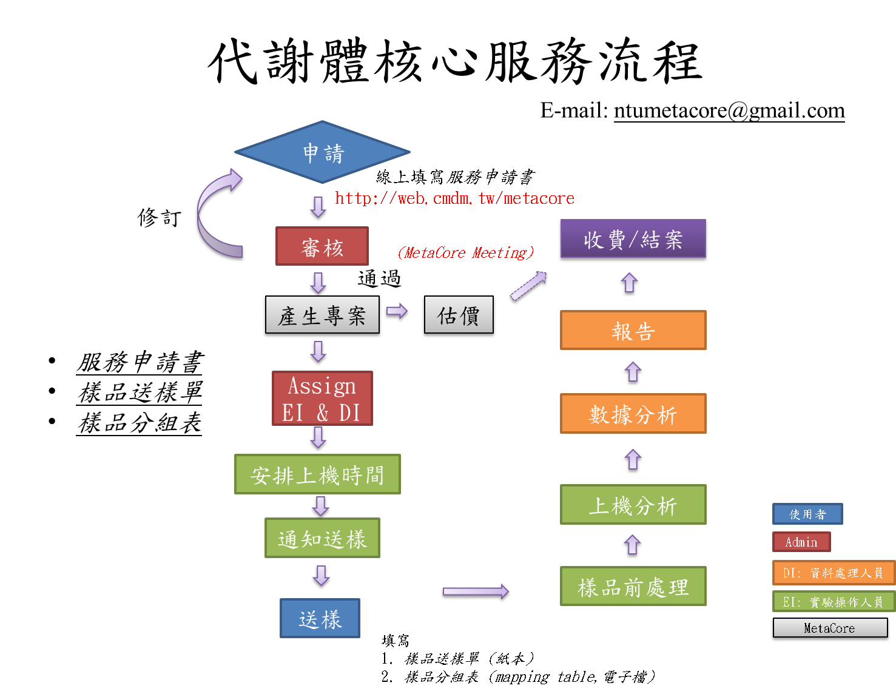

以下整理出Metacore使用者常遇到的問題，供您做參考。在[服務詢問](#1-服務詢問)中，您會知道我們所提供的服務。在[實驗分析流程詢問](#3-實驗分析流程詢問)中，您將瞭解您的資料是如何產生、處理。在最後的[報告解讀詢問](#4-報告解讀詢問)中，您會知道報告如何產生，以及如何使用報告做進一步統計分析或是期望的資料呈現。

若您的問題並不在以下內容中，請和**Metacore Lab** (ntumetacore@gmail.com) 聯絡做進一步詢問。

## 1. 服務詢問

### 1.1. 代謝體分析的服務流程為何?

我們代謝體核心的服務流程如下圖所示。

### 1.2. 代謝體核心實驗室提供那些服務項目?

目前核心實驗室已經完成開發的項目如下表所示，如有特別需求，需要客製化服務則請與實驗室PI聯絡。

| # | Packages | 說明 | Type |
|---|---|---|---|
| 1 | LC-MS metabolic profiling | 小分子代謝體分析，如果沒有特定標的代謝物建議先申請此項分析。 | Profiling |
| 2 | LC-MS untargeted profiling, including metabolic profiling | 無特定標的小分子代謝體分析，包含小分子代謝體分析 | Profiling |
| 3 | LC-MS polar metabolic profiling | 極性代謝體分析 | Profiling |
| 4 | LC-MS lipidomic profiling | 脂質代謝體分析 | Profiling |
| 5 | GC-MS metabolic profiling |  | Profiling |
| 6 | Fatty Acid Relative Quantitation Analysis 相對定量分析 | C12\~C26 二十三種脂肪酸相對定量 | Targeted analysis |
| 7 | Fatty Acid Absolute Quantitation Analysis 絕對定量分析 | C12\~C26 二十三種脂肪酸絕對定量 | Targeted analysis |
| 8 | Sphingolipid Relative Quantitation Analysis | 十六種Sphingolipid相對定量分析 | Targeted analysis |
| 9 | Fecal Short Chain Fatty Acid analysis | C2\~C5六種短鍊脂肪酸絕對定量 | Targeted analysis |
| 10 | Choline, Carnitine, Trimethylamine, Trimethylamine N-oxide analysis (Plasma, Urine) | Choline, Carnitine, Trimethylamine, TMAO絕對定量 | Targeted analysis |
| 11 | 標的代謝物定量 | 收費依不同代謝物而異 | Targeted analysis |

\* Fatty acid Analysis目前設計為血液的萃取方法，若其他的樣品基質，都會需要再做萃取開發條件上的確認，需要一段時間才能建立。

### 1.3. 如何申請代謝體核心實驗室的各項服務?

代謝體核心實驗室服務申請網站： <https://web.cmdm.tw/metacore/>

申請流程與系統操作請參閱 [how-to-apply-metacore.docx](../files/how-to-apply-metacore.docx)

代謝體分析，可分為Targeted metabolomics analysis與Untargeted metabolomics analysis。

Targeted metabolomics analysis可針對一定數量已知代謝物，藉由比較標準品進行定性分析。Untargeted metabolomics analysis則是試著偵測單一樣品中所有包含已知或未知之代謝物。本核心實驗室提供這兩類分析服務。

### 1.4. 如何選擇分析平台?

一般來說，若是貴單位已經有明確的分子target則建議使用 targeted analysis項目，如果沒有特定的目標則建議先使用LC-MS metabolic profiling或是GC-MS metabolomic profiling 做初步分析; 若想看的代謝物屬極性較高分子，可選擇LC-MS polar metabolic profiling ; 若是想看脂質的變化則建議選擇LC-MS lipidomic profiling 或是Fatty Acid Analysis。

### 1.5. 是否可以協助尋找某一種代謝物？

可以，但會分成以下兩種狀況：

1\. 您有興趣的代謝物有在我們建立的標準品資料庫中：

我們可以幫您偵測，且如果在搜尋範圍(分子量&滯留時間)內有偵測到多個峰值，這將是目前分析方法的限制。

2\. 您有興趣的代謝物不在標準品資料庫中：

我們依然可以幫您偵測，但因為沒有標準品做確認，故不確定性較高。

### 1.6. 是否有提供untargeted metabolomic profiling的服務？

Untargeted metabolomics profiling analysis試著偵測單一樣品中所有包含已知或未知之代謝物。本核心實驗室亦提供此項服務。

### 1.7. 是否可以協助實驗設計以及分組？

可以，請向**MetaCore Lab** (ntumetacore@gmail.com)聯絡，並與曾宇鳳教授與郭錦樺教授約時間討論。

## 2. 樣品前處理相關問題

### 2.1. 一般分析需要多少生物檢體量?

目前核心實驗室有接受的樣品種類有血清、尿液、CSF、肺泡沖洗液、組織、細胞、細胞培養液等等。一般的代謝體服務通常需要100 μl 的樣品量 (針對血清、尿液、CSF、肺泡沖洗液等biofluids)，組織需要10-20 mg，細胞則需要 1x106以上的細胞數目。

| 服務名稱 | 藥粉 | 組織 | 血漿 臨床 \| 動物 | 血清 臨床 \| 動物 | 尿液 臨床 \| 動物 | CSF | 細胞 | 細胞培養液 | Note |
|---|---|---|---|---|---|---|---|---|---|
| LC-MS metabolic profiling 小分子代謝體分析 | NA | 50-100 mg | 100 μl | 100 μl | 100 μl | 100 μl | 10^6 | 100 μl |  |
| LC-MS polar metabolic profiling 極性代謝體分析 | NA | 50-100 mg | 100 μl | 100 μl | 100 μl | 100 μl | 10^6 | 100 μl |  |
| LC-MS lipidomic profiling 脂質代謝體分析 | NA | 50-100 mg | 100 μl | 100 μl | 100 μl | 100 μl | 10^6 | 100 μl | 視欲測試lipid而定 |
| GC-MS metabolic profiling 小分子代謝體分析 | NA | 50-100 mg | 100 μl | 100 μl | 100 μl | 100 μl | 10^6 | 100 μl |  |
| Fatty Acid Analysis C14\~C26脂肪酸相對定量 | NA | 50-100 mg | 100 μl | 100 μl | testing | testing | testing | testing |  |

### 2.2. 血液尿液等臨床檢體的檢體收集注意事項?

臨床檢體注意事項請參考[代謝體核心實驗室樣品採集流程](../files/sample-collection-protocol.pdf) 。

### 2.3. 是否建議自行樣品萃取?

一般來說，大部分的樣品種類我們都可以代為萃取，細胞樣品因為不易保存，所以建議使用者自行萃取。

細胞萃取的建議作法請參考 [cell-extraction-protocol.pdf](../files/cell-extraction-protocol.pdf)

### 2.4. 檢品要如何運送?

檢品皆須在低溫下運送，在運送過程中，請用保麗龍盒裝著並置入適量保冷冰袋或是乾冰。送件地址為: 台北市中正區徐州路2號 509室 代謝體核心實驗室。

由於代謝體核心實驗室冰箱時常滿載，建議等候機器排程狀況由我們主動通知送樣時間，如果想知道可能的送樣時間，可以與代謝體核心實驗室詢問 (02-23123456 \#288781)

## 3. 實驗分析流程詢問

### 3.1. 每個樣本會有幾個replicate ？

本核心實驗室採用technical replicate，即同樣的樣本採取重覆相同測量，而產生的資料，確認訊號產生不是被雜訊所影響。在LC-MS實驗中為3 technical replicates per sample，GC-MS 為 1 technical replicate per sample。

### 3.2. Technical replicate 再現性是否會影響到代謝物挑選？

代謝物挑選是選取至少兩個replicates都有出現的peak，我們才會認為該代謝物是存在於樣品中。關於再現性，我們會在報告最後一欄CV (coefficient of variation)，以此數值代表此peak是否具有一定再現性，供您在分析上做取捨的參考。一般建議使用[FDA](http://www.fda.gov/downloads/Drugs/Guidances/ucm070107.pdf)提供的CV條件 (cv = 100\*s/m)， 選CV 15%以下會是比較具有意義的peak。

### 3.3. Peak 偵測方式為何？

在LC-MS上是用本核心實驗室開發的TIPick軟體偵測Peaks，會針對peak shape 評分，唯有分數超過門檻值的peak會留下來，並只保留出現超過一定比例replicate的peak。

舉例說明：

peak A在總共3個replicate中，在2個replicate被偵測到，peak A 將被保留；

peak B在總共3個replicate中，只在1個replicate被偵測到，peak B 將被捨去。

在GC-MS上則是採用本核心開發的IDMass軟體來完成此動作，首先會挑出明顯的elution profiles，並對選定之elution profile偵測local maximal，再對各elution profile同時間點之訊號進行訊號強度排序，並只保留前10大local maxima，最後統計該時間點之local maxima 數量，若超過一定門檻值，則該時間點有peak存在。

Citation:

TIPick: Ho, T. J., Kuo, C. H., Wang, S. Y., Chen, G. Y., & Tseng, Y. J. (2013). True ion pick (TIPick): a denoising and peak picking algorithm to extract ion signals from liquid chromatography/mass spectrometry data. *Journal of Mass Spectrometry*, *48*(2), 234-242.

IDMass:

### 3.4. 是否會根據實驗設計選用不同的統計方式？

一般未指明分析會採用基本的統計分析 (Kruskal test, T-test, and Wilcoxon rank sum test)，並根據以下判斷原則採用不同的統計方式：

1\. Kruskal test: 多組別 (多於兩組)比較。

2\. Student’s T-test: 兩個組別比較，各組中樣本數大於10。

3\. Wilcoxon rank sum test ：兩個組別比較，各組中樣本數不大於10。

至於適當的統計方式建議，可以在您取得分析報告後與**Metacore Lab** (ntumetacore@gmail.com)聯絡並與曾宇鳳教授約時間討論並詢問是否有合適或是建議的統計分析方式。

**相關閱讀：**

1\. Myles Hollander and Douglas A. Wolfe (1973), Nonparametric Statistical Methods. New York: John Wiley & Sons. Pages 115–120.

2\. David F. Bauer (1972), Constructing confidence sets using rank statistics. Journal of the American Statistical Association 67, 687–690.

## 4. 報告解讀詢問

### 4.1. 為何報告中會有同名的代謝物？

初步定性分析中，若該代謝物的搜尋範圍內，偵測到多個波峰，多個波峰皆有可能是該代謝物，此為本分析方法限制。

從PeakTable內每一個row代表一個波峰訊號，而不是一個row為一個代謝物，所以在檔案內標註是PeakName，而不是MetaboliteName。我們使用標準品資料庫的m/z與retention time (RT)對波峰比對，若比對到多個代謝物，則會以 \| 做區隔，例如: Betaine \| L-Valine

如果代謝物們m/z非常接近且RT也接近，代謝物們訊號是有可能交疊出現而被偵測到，所以如果想檢視的代謝物屬於極性小分子，我們會建議改用適合極性小分子的HILIC分析平台 （LC-MS polar metabolic profiling），可將極性小分子更有效分離避免代謝物交疊出現情形。

如果代謝物名字後面有 (1) (2) 則代表該代謝物的m/z與RT容忍範圍內有偵測到多個波峰，數字代表出現的順序，如L-Alanine (1)，L-Alanine (2)為偵測到兩個波峰都可能是L-Alanine，如果經統計檢定判斷是顯著差異的波峰，可以進行MS/MS實驗再確認。

PeakName後面\[M+H\]+或\[M+Na\]+代表小分子經過離子化之後帶有氫離子或鈉離子而被偵測到。

### 4.2. 報告中數值代表的意思為何？

一般使用者常會誤認為報告中數值即為偵測到之代謝物濃度，但此數值真正意思為**訊號強度**：可以視為和濃度有正比關係。至於數值0則是代表是扣除空白樣品(solvent blank)後的代謝體波峰高，雖然有偵測到，但該代謝體並非來自樣本而可能是來自背景訊號。

### 4.3. 報告中波峰高數值是計算replicates平均或是中位數？

是以中位數計算。取平均可能會因其中存在波峰高為0的technical replicate，使取平均後大幅影響真正波峰高數值。

### 4.4. 報告的結果是定量還是定性？

我們提供的服務有分相對定量和絕對定量

1\. 相對定量(僅提供訊號強度值)：

LC-MS metabolic profiling (T3 column)

LC-MS lipidomic profiling

LC-MS polar metabolic profiling (HILIC column)

GC-MS metabolic profiling

Fatty Acid Relative Quantitation Analysis - 23種脂肪酸相對定量分析

2\. 絕對定量(提供絕對濃度值)：

Fatty Acid Absolute Quantitation Analysis - 23種脂肪酸絕對定量分析

如果在相對定量研究中發現具有統計差異的代謝物或是想對有興趣的代謝物做定量的分析，請向**Metacore Lab** (ntumetacore@gmail.com)聯絡。我們將為您做進一步的說明。

### 4.5. 分析報告包含許多檔案，我該用哪一個 ？

報告壓縮檔內含有以下資料：

1\. Boxplot\_\*\_Analysis_1 （\*可能為pos/neg代表LC-MS報告，若為GC-MS則為GC-MS報告）

存放有統計差異的箱型圖 (png)

2\. MetaCoreResult\_\*\_Analysis_1

含有統計分析完有顯著差異之代謝體在各組間的資訊

3\. PeakTable\_\*

紀錄完整的各樣本在各代謝物中的波峰值

4\. PathwayAnalysis\_\*

存放有Pathway Enrichment Analysis報告

## 5. 未分類之詢問

### 5.1. Pilot study 會建議使用多少樣本？

一般建議是約30個樣本，如仍有疑問請向**Metacore Lab** (ntumetacore@gmail.com)聯絡並與曾宇鳳教授與郭錦樺教授約時間討論樣本數是否足夠進行pilot study。

### 5.2. 請問要如何引用你們的實驗數據處理方法？

所有在LC-MS平台上分析完的數據透過TIPick這套演算法分析，而資料若有涉及多個batch，則會使用到BatchNormalizer這套演算法來解決分批樣本處理過程中產生的訊號大小差異。另外若有申請metabolic pathway analysis，則需要引用3omics。

以下為處理過程中提及之數據處理方法之論文連結與APA format citation。

True ion pick (TIPick): a denoising and peak picking algorithm to extract ion signals from liquid chromatography/mass spectrometry data ([連結](http://www.ncbi.nlm.nih.gov/pubmed/23378096))

Ho, T. J., Kuo, C. H., Wang, S. Y., Chen, G. Y., & Tseng, Y. J. (2013). True ion pick (TIPick): a denoising and peak picking algorithm to extract ion signals from liquid chromatography/mass spectrometry data. *Journal of Mass Spectrometry*, *48*(2), 234-242.

Batch Normalizer: A Fast Total Abundance Regression Calibration Method to Simultaneously Adjust Batch and Injection Order Effects in Liquid Chromatography/Time-of-Flight Mass Spectrometry-Based Metabolomics Data and Comparison with Current Calibration Methods ([連結](http://pubs.acs.org/doi/abs/10.1021/ac302877x))

Wang, S. Y., Kuo, C. H., & Tseng, Y. J. (2012). Batch Normalizer: a fast total abundance regression calibration method to simultaneously adjust batch and injection order effects in liquid chromatography/time-of-flight mass spectrometry-based metabolomics data and comparison with current calibration methods. *Analytical chemistry*, *85*(2), 1037-1046.

3Omics: a web-based systems biology tool for analysis, integration and visualization of human transcriptomic, proteomic and metabolomic data ([連結](http://www.biomedcentral.com/1752-0509/7/64))

Kuo, T. C., Tian, T. F., & Tseng, Y. J. (2013). 3Omics: a web-based systems biology tool for analysis, integration and visualization of human transcriptomic, proteomic and metabolomic data. *BMC systems biology*, *7*(1), 64.

### 5.3. 教授聯絡資訊

| 姓名職稱 | 電話 | e-mail |
|---|---|---|
| 曾宇鳳教授 | (02) 3366-4888 #529 | yjtseng@csie.ntu.edu.tw |
| 郭錦樺教授 | (外線) (02) 3366-8766  (臺大內線)先撥606，再撥68766 | kuoch@ntu.edu.tw |

### 5.4 請問是否有使用你們分析服務發表之論文清單？

- [The metabolome profiling and pathway analysis in metabolic healthy and abnormal obesity.](http://www.ncbi.nlm.nih.gov/pubmed/25907313)
- [Fasting but not changes of plasma metabolome during oral glucose tolerance tests improves the diagnosis of severe coronary arterial stenosis.](http://www.ncbi.nlm.nih.gov/pubmed/25557422)
- [Metabolomics of ginger essential oil against alcoholic fatty liver in mice.](http://www.ncbi.nlm.nih.gov/pubmed/24171385)
