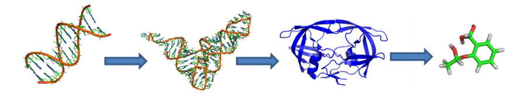
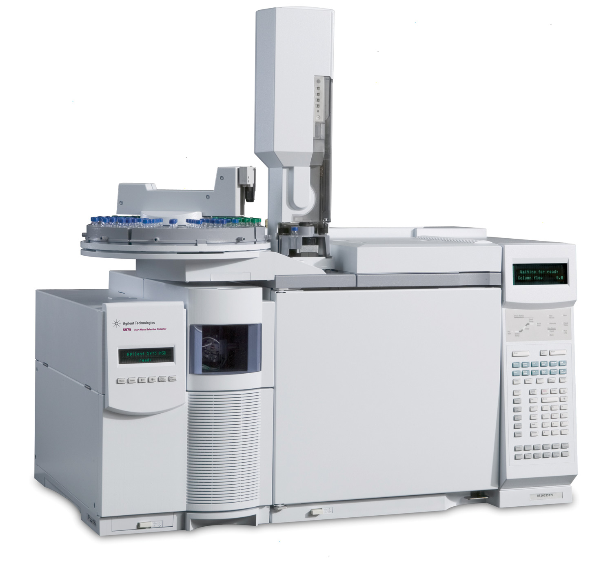
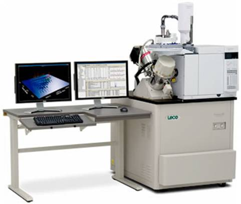

台大基因體研究中心代謝體核心實驗室 MetaCore 成立的宗旨，主要是以領先全球的代謝體分析技術，提供代謝體的構成資訊，以促進轉譯研究與人體健康。基於跨專業領域技術的核心技術，代謝體核心實驗室 MetaCore 成為基礎研究和臨床診斷的橋樑，將代謝體相關學說的研究實現為影響及改善未來個人化醫療發展的先進技術。代謝體學主要的目標是「定量的研究生命系統對病理、生理刺激或基因突變的動態代謝體反應 (代謝物) 」。代謝體學與基因體學、轉錄體學、蛋白質學都是分子生物學的主要研究範疇 (圖例 1)。

<figure class="wide">

<figcaption>圖例 1: 分子生物學的中心理念與代謝體</figcaption>
</figure>

正如基因體學乃是致力於解開基因體結構，代謝體學則是著重在了解從細胞、器官或有機體的代謝過程中所產生的許多小分子代謝物。人體自成的代謝物大約有 5,000 - 20,000 種，透過分析這些代謝體產物正可以提供我們精確的輪廓，可及時了解在特定的時間內細胞/器官/組織的生理機能。就好像透過細胞的基因型式，可以預知它的生理現象限制的範圍，代謝體分析則能夠預測最接近的表現型式，因此可以很容易地發現對於的疾病、營養、藥物治療和基因突變的立即影響。代謝體的分析最強大的能力在於是直接透過分子結構說明一切變化，因此生理狀態的改變、強調重點或是異常都可以透過特徵描述及生物標記來確認。而辨識出來的生物標記亦可以引導出更先進的技術用來作為疾病診斷和預測的機械論假設。

本中心所提供的 4 種主要的代謝體學分析儀器包括：

<figure class="instrument">

<figcaption>1. 超高壓液相色譜-串聯四極桿質譜儀 (UHPLC-MS/MS)</figcaption>
</figure>
<figure class="instrument">

<figcaption>2. 超高壓液相色譜-四極柱飛行時間質譜儀 (UHPLC-QTOF)</figcaption>
</figure>
<figure class="instrument">

<figcaption>3. 氣相色譜-四極柱質譜儀 (GC-MS)</figcaption>
</figure>
<figure class="instrument">

<figcaption>4. 二維氣相色譜-飛行時間質譜儀 (GC´GC-TOFMS)</figcaption>
</figure>

同時也歡迎本中心服務的使用者 (包括校內和校外)， 在進行申請服務前可先與本中心的研究人員進行討論。可以根據使用的儀器選擇適合的方式，目前已有多種參與本服務的方式：單一案件服務、併同多次案件實驗設計、測試、進行實驗、錯誤排除以及資料分析。
